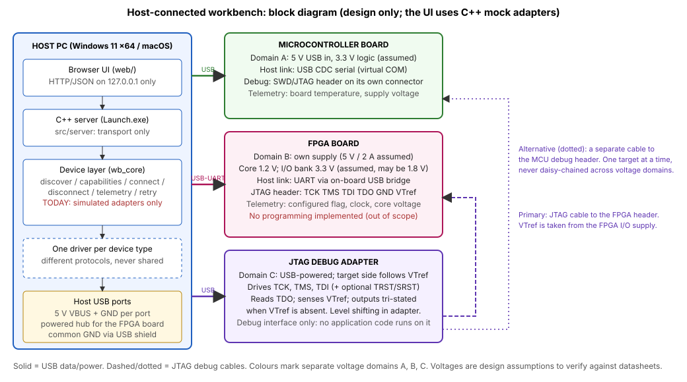

# Task E: Embedded-system integration design

Scope: a design for a host-connected workbench with **one microcontroller board, one FPGA board and one JTAG debug adapter**. Only the host-side discovery/connect/telemetry/recovery logic is implemented, as **C++ mock adapters** (`src/core/devices.*`). Nothing in this repository talks to real hardware, and all UI output for this view is labelled SIMULATED.

## Interface and voltage table

All voltages are **assumptions for a typical hobby/evaluation setup**, not properties of any specific product. Each real board must be checked against its own datasheet before connecting anything.

| Item | Microcontroller board | FPGA board | JTAG adapter |
|---|---|---|---|
| Role | Runs firmware; sensor/control node | Programmable-logic target | Debug interface to a target's TAP; does not compute |
| Power in | 5 V from host USB (VBUS) | Own 5 V / 2 A supply (not from a bus-powered port) | 5 V from host USB (VBUS) |
| Voltage domain | A: 3.3 V logic | B: core 1.2 V, I/O bank 3.3 V (may be 1.8 V or 2.5 V) | C: adapter core 3.3 V; **target-side I/O follows VTref** |
| Ground | Common GND to host via USB shield | Common GND via the adapter's GND pins and USB shield | GND pin on JTAG cable is the reference for all JTAG signals |
| Host communication | USB CDC-ACM (virtual COM), line-framed telemetry | UART through the board's USB-UART bridge | USB with a vendor/probe protocol (e.g. MPSSE or CMSIS-DAP style); not a serial console |
| Debug connector | SWD/JTAG header (its own pin-out) | JTAG header: TCK, TMS, TDI, TDO, GND, VTref | Target cable per target; **no assumed common connector** |
| Level shifting | None needed at 3.3 V host-side; add a buffer if a 5 V peripheral is attached | Required if bank voltage is not 3.3 V | Built in; output buffers powered from VTref |
| Pinout assumption | Documented per board in a device profile | Documented per board in a device profile | Pin-out per target cable; profile selects it |

### JTAG signal ownership

| Signal | Driven by | Notes |
|---|---|---|
| TCK, TMS, TDI | Adapter | Series resistors (about 22 to 33 ohm) close to the adapter limit ringing and fault current |
| TDO | Target | The adapter only receives it |
| TRST / SRST | Adapter (optional) | Open-drain preferred; use only if the target exposes them |
| VTref | Target | Target I/O supply, **sensed** by the adapter. The adapter does not power the target through it |
| GND | Shared | At least one GND per signal group on the cable |

## Why a JTAG adapter is not an interchangeable board

A JTAG adapter has no application processor, no firmware the user writes and no sensor values of its own. Its job is to move bit patterns on TCK/TMS/TDI/TDO into a target's test-access port. Its capabilities (chain scan, TCK rate, VTref sense) are properties of the **link**, not of a compute node. In the software model it therefore reports different capabilities and different telemetry (`target_vref`, `tck`, `devices_in_chain`) from the MCU and FPGA, and it needs a target to be meaningful. Boards also differ in connector, voltage and protocol, so each device type has its **own driver** behind a common interface (`discover`, `capabilities`, `connect`, `disconnect`, `readTelemetry`), and nothing assumes a shared connector, voltage or protocol.

## Safe integration plan

1. **Paper review first.** Read each board's datasheet for I/O voltage, absolute maximum ratings and JTAG pin-out. Fill in the device profile.
2. **Bench power only.** Power each board from its own supply with a current limit, with no signal cables attached. Measure the rails (3.3 V, core, VTref) before any connection.
3. **Common ground, then signals.** Connect ground first. Add USB data cables, one board at a time, and confirm enumeration and telemetry.
4. **JTAG last, one target at a time.** Check VTref on the target header. Connect the adapter to the FPGA only. Run a chain scan and confirm the expected IDCODE. Only afterwards consider the MCU debug header, with a separate cable.
5. **Never daisy-chain across domains.** The MCU and FPGA are not placed on one JTAG chain unless they share the same I/O voltage and the target documentation allows it.
6. **Fail safe.** The adapter tri-states its outputs when VTref is absent. The host treats a missing device, a timeout or an unexpected voltage as an error, and does not retry writes blindly.
7. **ESD and handling.** Use an earthed wrist strap, avoid hot-plugging JTAG cables on a powered target, and keep wires short.

## What the mock adapters demonstrate

- Discovery of all three device types and capability reporting.
- Connect and disconnect with explicit errors (not found, already connected, not connected).
- One telemetry message per device type, with a sequence number and `simulated: true`.
- **One recoverable failure:** "Simulate timeout" makes the next connect or telemetry call time out. "Connect with retry" retries up to 3 times and reports the number of attempts; a telemetry timeout leaves the device connected, so the next read succeeds. If retries are exhausted, it gives up with a clear message instead of looping.
- Unit tests: `tests/test_devices.cpp`.

## Limitations

- No real I/O, USB enumeration, serial framing, JTAG bit-banging or FPGA programming. These are explicitly out of scope.
- Telemetry values are synthetic (smooth functions of a counter).
- The voltage table is an assumption set, not a verified design. A real build needs datasheet checks, a power-budget calculation, and review of ESD and layout.
- Retry back-off is simulated (not slept), and there is no concurrency control beyond a mutex.
